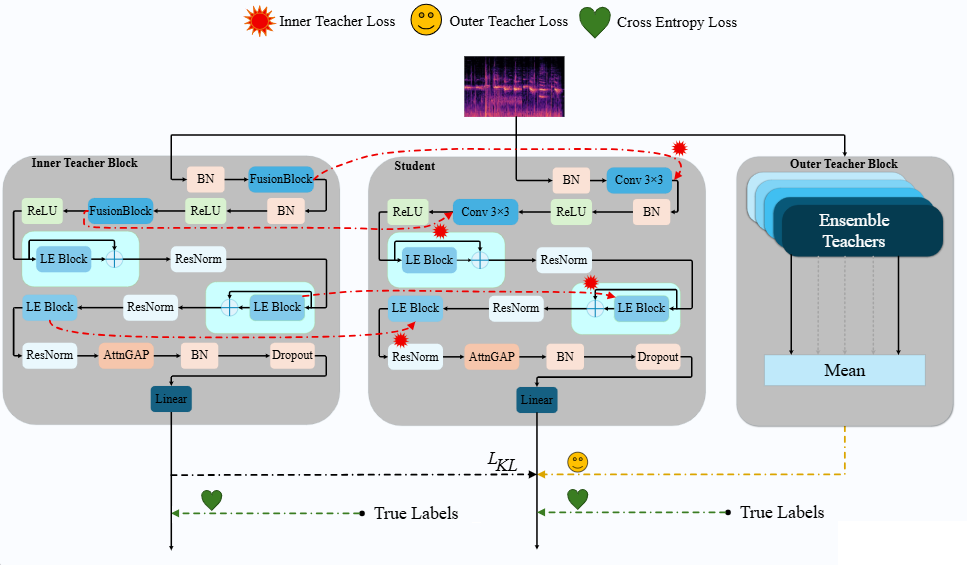

# LightEchoNet: Structurally Aligned Inner–Outer Knowledge Distillation for Lightweight Audio Classification

Official PyTorch implementation and released checkpoints for **"LightEchoNet: Structurally Aligned Inner–Outer Knowledge Distillation for Lightweight Audio Classification."**

> **Authors:** Mohamad Mahdee Ramezanee\*, Hossein Sharifi\*, Behnam Raoufi\*, Reza Tavakoli, Siavash Ahmadi†, Babak Khalaj, Saeed Bagheri Shouraki, Mohammad Sabokrou, Ali Diba†
> \* Equal contribution. † Corresponding authors.
>
> Sharif University of Technology · Virginia Tech · New Uzbekistan University · Okinawa Institute of Science and Technology · QCRI, Hamad Bin Khalifa University

**Project page:** https://acoustilight.github.io/LightEchoNet

<p align="center">
  
</p>


## 📖 Abstract

> We present LightEchoNet, a lightweight audio classification framework designed for resource-constrained devices. Its compact CNN student provides strong standalone performance with low parameter and computational costs. The Inner Block is structurally aligned with the student and uses FusionConv blocks to produce compatible intermediate representations without additional projection modules. The proposed staged distillation strategy combines normalized Huber-based feature matching and temperature-scaled logit supervision from the Inner Block with complementary output-level guidance from the Outer Block. The final student achieves 60.24% accuracy on TAU using the official 25% development-training subset, 93.4% on ESC-50, and 94.43% on UrbanSound8K. For a one-second audio clip, the model requires only 31.2K parameters, 28.6 MMACs, and 62.5 kB of storage in float16 format.


## 🧩 Method

LightEchoNet co-designs a compact CNN **student** with a structurally aligned **Inner Teacher**, then distills from an **Outer Teacher** ensemble. Nine aligned teacher–student (T–S) block pairs are distributed through the network so intermediate features can be matched directly, with no extra projection modules. Training uses three phases:

- **Phase I — Inner Teacher:** train the structurally aligned inner teacher, whose FusionConv blocks mirror the student's `3×3` convolutions.
- **Phase II — Student (inner KD):** train the student with cross-entropy, temperature-scaled KL on inner-teacher logits, and a normalized Huber feature-matching loss (`α = 0.6`, `β = 0.8`, `T = 5`).
- **Phase III — Student (outer KD):** emphasize the outer-teacher ensemble with `T = 8`, `α = 0.95`.

All teachers are discarded after training, so inference cost is unchanged. **This repository releases the trained students and the evaluation code**; the student is the only network required to reproduce the reported accuracies.


## ⚙️ Setup

```bash
git clone https://github.com/<your-org>/LightEchoNet.git
cd LightEchoNet

conda create -n lightechonet python=3.9
conda activate lightechonet

# Adjust the CUDA build to your system.
conda install pytorch==2.1.0 torchaudio==2.1.0 pytorch-cuda=11.8 -c pytorch -c nvidia
pip install -r requirements.txt
```

The pipeline uses `torchaudio` for waveform loading and resampling; make sure your `torchaudio` backend can decode the dataset audio (e.g. FFmpeg).


## 🤖 Model

The released student (`models/student.py`) is a compact CNN: a two-layer stem, three stages of Light Echo (LE) blocks with Residual Normalization, an attention-based pooling head, and a linear classifier — about **31.2K parameters** for a one-second input. Checkpoints are raw tensor-only state dicts loaded with `strict=True`, so the architecture must not be modified.


## 📁 Data Preparation

| Dataset | Status | Classes | Protocol |
|---|---|---|---|
| [ESC-50](https://github.com/karolpiczak/ESC-50) | ✅ Supported | 50 | Official 5-fold cross-validation |
| [UrbanSound8K](https://urbansounddataset.weebly.com/urbansound8k.html) | 🚧 Checkpoints released; loader coming | 10 | Official 10-fold cross-validation |
| [TAU Urban Acoustic Scenes 2022 Mobile](https://zenodo.org/record/6337421) | 🚧 Coming | 10 | Official 25% dev-train split |

All audio is converted to mono and resampled to **32 kHz**. Log-Mel features use FFT size **4096**, hop length **502**, **256** mel bands, power **2.0**, and an **80 dB** dynamic range (see `configs/esc50.yaml`).

### ESC-50 layout

Point `--data-root` at a directory containing `esc50.csv` (any of the standard locations is auto-detected) and the `audio/` folder:

```text
/path/to/ESC-50/
├── meta/esc50.csv
└── audio/*.wav
```

The metadata loader strictly validates the 2000 clips / 5 folds / 50 classes before running.


## 🚀 Evaluation

Place the per-fold checkpoints under `checkpoints/esc50/`, named either `fold<N>.pth` or `fold<N>.ESC50_<accuracy>.pth` (the second form lets the evaluator report the difference from the filename accuracy):

```text
checkpoints/esc50/
├── fold1.ESC50_93.50.pth
├── fold2.pth
├── ...
└── fold5.pth
```

Run 5-fold evaluation:

```bash
python evaluate.py \
  --config configs/esc50.yaml \
  --data-root /path/to/ESC-50 \
  --checkpoints-dir checkpoints/esc50
```

The script prints per-fold accuracy plus the arithmetic mean, population/sample variance and standard deviation, and the pooled accuracy across all folds.


## 📊 Results

Student accuracy on the official folds (from the paper):

| Dataset | Accuracy (%) | Params | MMACs | Size (float16) |
|---|---|---|---|---|
| TAU (25% dev-train) | 60.2 | 31.2K | 28.6 | 62.5 kB |
| ESC-50 | 93.4 ± 0.9 | 36K | — | — |
| UrbanSound8K | 94.4 ± 1.9 | 31.2K | — | — |

Scaling the student to ~350K parameters (`LightEchoNet-350K`) raises ESC-50 to **95.8 ± 0.83%** and UrbanSound8K to **96.25 ± 1.72%**.


## 🛠️ Status

- **ESC-50 evaluation:** fully supported.
- **UrbanSound8K:** checkpoints are released; the dataset loader and config are being added.
- **TAU + training code (inner/outer teachers, distillation losses, augmentations):** planned.


## 📝 Citation

```bibtex
@inproceedings{ramezanee2026lightechonet,
  title     = {LightEchoNet: Structurally Aligned Inner--Outer Knowledge Distillation for Lightweight Audio Classification},
  author    = {Ramezanee, Mohamad Mahdee and Sharifi, Hossein and Raoufi, Behnam and Tavakoli, Reza and Ahmadi, Siavash and Khalaj, Babak and Bagheri Shouraki, Saeed and Sabokrou, Mohammad and Diba, Ali},
  booktitle = {TODO: fill in venue},
  year      = {2026}
}
```
